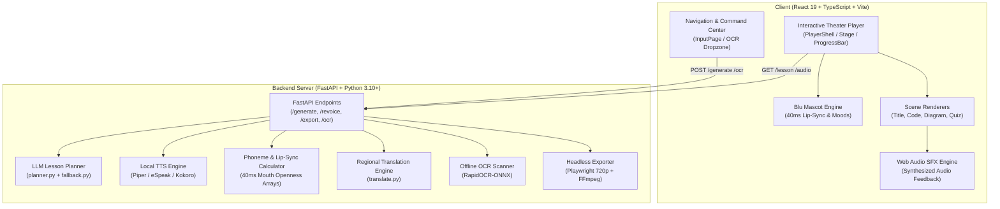

# 📘 Blu Visual Teacher (Unlox) — Complete Project Documentation

> **Offline-first AI Educational Video Generator & Interactive Lesson Studio**  
> Transforms coding and conceptual topics into smooth, animated, narrated visual walkthroughs with an interactive mascot, synchronized neural audio, execution memory diagrams, and regional language support.

---

## 📑 Table of Contents

1. [Executive Overview & Vision](#1-executive-overview--vision)
2. [High-Level Architecture](#2-high-level-architecture)
3. [Technology Stack](#3-technology-stack)
4. [Data Contracts & Schemas](#4-data-contracts--schemas)
5. [Frontend Architecture & Components](#5-frontend-architecture--components)
6. [Backend Architecture & Engine](#6-backend-architecture--engine)
7. [API Reference](#7-api-reference)
8. [Offline-First Capabilities](#8-offline-first-capabilities)
9. [UI/UX & Design System](#9-uiux--design-system)
10. [Local Setup & Running Guide](#10-local-setup--running-guide)
11. [Troubleshooting & FAQ](#11-troubleshooting--faq)

---

## 1. Executive Overview & Vision

**Unlox (Blu Visual Teacher)** is an offline-capable, interactive educational engine inspired by the visual clarity of **3Blue1Brown (Manim)**, the pedagogy of **Khan Academy**, and the engagement of **Duolingo**.

### The Problem It Solves
- **Abstract Logic**: Code execution, recursion stacks, and memory pointers are notoriously difficult to grasp from static textbook text or code dumps.
- **Connectivity Gaps**: In rural or bandwidth-constrained classrooms, streaming heavy video tutorials is impossible.
- **Language Barriers**: High-quality computer science education is overwhelmingly English-centric, leaving vernacular language learners at a disadvantage.

### The Unlox Solution
1. **Deterministic Generative Engine**: Generates complete, animated lessons with vector diagrams, syntax-highlighted code execution traces, and knowledge checks from any topic prompt or textbook photo.
2. **Offline-First Resilience**: All fonts, TTS models, OCR engines, mascots, and audio run locally on-device without internet.
3. **Multilingual by Design**: Automatic, instant revoicing into major Indian regional languages (**Hindi**, **Kannada**, **Tamil**, **Telugu**, **Bengali**).
4. **Cinematic Interactive Player**: Synchronized teacher mascot (**Blu**) with 40ms phoneme lip-sync, chapter timeline markers, and in-browser Web Audio tactile sound effects.

---

## 2. High-Level Architecture



---

## 3. Technology Stack

### Frontend
- **Framework**: React 19 (`react`, `react-dom`)
- **Language**: TypeScript 5.8+ (Strict Type Checking)
- **Build Tool**: Vite 8.3+ (Sub-second HMR and optimized rollups)
- **Styling**: Vanilla CSS with modern HSL tokens, glassmorphism utilities, and CSS keyframe micro-animations
- **Offline Typography**: `@fontsource` bundled locally:
  - `@fontsource/noto-sans` (Latin & General UI)
  - `@fontsource/jetbrains-mono` (Code & Variable Traces)
  - `@fontsource/opendyslexic` (Dyslexia-Friendly Mode)
  - `@fontsource/noto-sans-devanagari` (Hindi & Marathi)
  - `@fontsource/noto-sans-kannada` (Kannada)
  - `@fontsource/noto-sans-tamil` (Tamil)
  - `@fontsource/noto-sans-telugu` (Telugu)
  - `@fontsource/noto-sans-bengali` (Bengali)
- **Sound Effects**: In-browser **Web Audio API** oscillator synthesis (zero external audio files).

### Backend
- **Framework**: FastAPI (Asynchronous Python Web Framework)
- **Data Validation**: Pydantic v2 (Strict schema contracts)
- **OCR Engine**: `rapidocr-onnxruntime` (Offline lightweight image text recognition)
- **Video & Audio Muxer**: FFmpeg + Playwright Headless Chromium (720p frame capture)
- **Audio Processing**: `wave`, `pydub`, `scipy`

---

## 4. Data Contracts & Schemas

### 4.1 Lesson JSON Specification
Every lesson is a deterministic data object rendered as a pure mathematical function of time $t$:

```typescript
export type Level = 'beginner' | 'intermediate' | 'advanced';
export type SceneMood = 'happy' | 'thinking' | 'excited' | 'curious';

export interface BaseScene {
  id: string;               // Unique scene identifier
  heading: string;          // On-screen header
  narration: string;        // Text spoken by the narrator
  caption?: string;         // Translated regional caption (defaults to narration)
  duration_ms: number;      // Exact duration in milliseconds calculated from audio
  audio_url?: string;       // Path to served audio file (e.g. /audio/lesson-01/scene_0.wav)
  mood?: SceneMood;         // Mascot expression: happy | thinking | excited | curious
  mouth?: number[];         // 0..1 mouth openness values (1 value per 40ms step)
}

export interface TitleCardScene extends BaseScene {
  type: 'title_card';
  subtitle?: string;
}

export interface DiagramArrow {
  from: number;             // Index of source node
  to: number;               // Index of target node
  label?: string;           // Arrow edge label
}

export interface DiagramScene extends BaseScene {
  type: 'diagram';
  items: string[];          // List of node labels
  arrows?: DiagramArrow[];
}

export interface CodeWalkthroughScene extends BaseScene {
  type: 'code_walkthrough';
  code: string;             // Raw source code
  highlight_lines: number[]; // 1-based line numbers for each execution step
  language_label?: string;  // e.g. "Python"
  trace?: Array<{
    line: number;
    vars: Record<string, string | number>; // Variable state at this step
  }>;
}

export interface QuizScene extends BaseScene {
  type: 'quiz';
  question?: string;
  options?: string[];
  answer_idx?: number;      // 0-based correct answer index
  explanation?: string;     // Pedagogical explanation on submit
}

export type Scene = TitleCardScene | DiagramScene | CodeWalkthroughScene | QuizScene;

export interface Lesson {
  id: string;
  title: string;
  level: Level;
  language: string;
  scenes: Scene[];
  source?: string;
  error?: string;
}
```

### 4.2 Timing Contract (`timing.json`)
The timing contract matches each audio waveform to exact scene intervals:

```json
{
  "language": "en",
  "total_seconds": 62.4,
  "scenes": [
    {
      "scene": 0,
      "audio": "scene_0.wav",
      "audio_url": "http://127.0.0.1:8000/audio/9fde59e56541/en/scene_0.wav",
      "start": 0.0,
      "duration": 5.2,
      "caption": "Welcome to Python For Loops!"
    }
  ]
}
```

---

## 5. Frontend Architecture & Components

```
src/
├── anim/            # Easing curves (easeOutCubic, easeOutBack) & camera transformations
├── api/             # API client functions (lessonApi.ts)
├── components/      # Global shared UI components
│   ├── GeneratingLoader.tsx  # Multi-stage live synthesis loader
│   ├── Navbar.tsx            # Persistent top header & theme selector
│   ├── SceneStage.tsx        # 1280x720 canvas container with ambient glow
│   └── VictoryModal.tsx      # Post-lesson completion & achievement screen
├── context/         # React Context for Learner Settings (Dyslexia, Speed, Voice)
├── mascot/          # Blu the Owl mascot engine (Blu.tsx, anchors.ts)
├── pages/           # Application views
│   ├── InputPage.tsx         # Multi-modal creation studio & live blueprint
│   ├── LibraryPage.tsx       # Offline saved lessons collection
│   └── StudyPlanPage.tsx     # Structured syllabus tracks & checklists
├── player/          # Theater player implementation
│   ├── CaptionBar.tsx        # Multilingual & dyslexia caption renderer
│   ├── Controls.tsx          # Play, pause, seek, speed, volume buttons
│   ├── DebugOverlay.tsx      # Diagnostic inspector for time t & mouth arrays
│   ├── PlayerShell.tsx       # Root player orchestrator & export handler
│   ├── ProgressBar.tsx       # Segmented chapter timeline & hover tooltips
│   ├── SceneRenderer.tsx     # Scene type dispatcher
│   ├── Stage.tsx             # Responsive 16:9 aspect-ratio scaler
│   └── usePlayer.ts          # RequestAnimationFrame player loop
├── scenes/          # Concrete scene visualizers
│   ├── CodeWalkthrough.tsx   # Code syntax highlighter & memory trace
│   ├── Diagram.tsx           # Vector node & arrow network visualizer
│   ├── QuizScene.tsx         # Interactive checkpoint with Web Audio SFX
│   └── TitleCard.tsx         # Entrance title banner
├── utils/           # Utility helpers
│   ├── audioSfx.ts           # Web Audio synthesizer for tactile sounds
│   ├── fonts.ts              # Script-specific font-family mappings
│   ├── library.ts            # LocalStorage persistence manager
│   └── quality.ts            # Auto performance detection
└── index.css        # Design tokens, themes & keyframe animations
```

---

## 6. Backend Architecture & Engine

### Core Modules (`backend/`):
- **`api.py`**: FastAPI routing, background multi-threading voice generation queue (`_bg_queue`), in-memory and disk caching (`lesson_cache.json`).
- **`planner.py`**: Formulates structured prompt chains for local LLMs; enforces pedagogy (motivation -> mental model -> code walk -> quiz).
- **`fallback.py`**: Deterministic, pre-validated offline lesson banks for core concepts, guaranteeing zero crash states even without an LLM.
- **`schema.py`**: Strict Pydantic models for scenes, duration validation, and language codes.
- **`tts.py`**: Local text-to-speech synthesis, duration measurement, and mouth openness calculation (0..1 per 40ms interval).
- **`translate.py`**: Regional Indian script translator (Hindi, Kannada, Tamil, Telugu, Bengali) with memory caching.
- **`ocr.py`**: Image-to-text extraction using `rapidocr-onnxruntime` for textbook and note ingestion.
- **`export.py`**: Automated headless browser capture using Playwright at 1280x720, combined with audio and SRT via FFmpeg.

---

## 7. API Reference

### `POST /generate`
Generates a complete new lesson from topic prompt or parameters.
- **Request Body**:
  ```json
  {
    "topic": "Python For Loops",
    "level": "beginner",
    "language": "en",
    "target_seconds": 90,
    "voice": "female",
    "local_context": true,
    "simpler": false
  }
  ```
- **Response**: Full Lesson JSON including scenes, durations, audio URLs, and mouth arrays.

### `POST /revoice`
Re-narrates an existing lesson in another language without re-generating scenes.
- **Request Body**:
  ```json
  {
    "lesson_id": "9fde59e56541",
    "lang": "kn",
    "voice": "female"
  }
  ```
- **Response**: Localized lesson with translated headings, captions, and Kannada audio.

### `GET /lesson/{lesson_id}/{lang}`
Retrieves a previously generated lesson directly from disk cache or triggers on-demand regional voice generation.

### `GET /lesson/{lesson_id}/voices`
Polls background synthesis status for all regional languages (`ready`, `generating`, `pending`, `available`).

### `POST /ocr`
Extracts raw text and automatically detects topic from an uploaded image file or base64 payload.
- **Response**: `{ "ok": true, "topic": "Binary Search", "text": "..." }`

### `POST /export`
Captures the rendered 1280x720 scene animation using Playwright and muxes audio + SRT into an MP4 file.
- **Response**: `{ "ok": true, "mp4_url": "/audio/...", "download_url": "/download/..." }`

### `GET /download/{lesson_id}/{lang}`
Direct attachment download of the exported 720p MP4 video.

---

## 8. Offline-First Capabilities

| Capability | Offline Technology | Fallback / Zero-Internet Strategy |
| :--- | :--- | :--- |
| **Typography** | Local `@fontsource` npm packages | 100% bundled in Vite build; zero Google Fonts CDN requests |
| **Text-to-Speech** | Local TTS (Piper / eSpeak / Kokoro) | Deterministic syllable timing & mouth pulse generator |
| **AI Lesson Plan** | Local LLM / Ollama | Comprehensive [fallback.py](file:///c:/Users/Asus/Unlox/backend/fallback.py) verified curriculum |
| **Image Recognition** | RapidOCR ONNX Runtime | Embedded onnx models running on local CPU |
| **Sound Effects** | Web Audio API | In-browser mathematical oscillator synthesis |
| **Video Export** | Playwright + Local FFmpeg | Local browser rendering + offline FFmpeg muxer |

---

## 9. UI/UX & Design System

### Curated Color Themes (Non-Black Palette)
Users can dynamically switch color schemes via the top navigation bar:

1. **🌌 Cosmic Navy (Default)**: Deep sapphire and midnight navy gradient (`#0e1c3a` ➔ `#102144` ➔ `#1d3a72`) with electric cyan accents.
2. **⛰️ Deep Slate**: Industrial steel and slate grey-blue (`#1e293b` ➔ `#334155`).
3. **🌲 Alpine Teal**: Nordic evergreen and spruce pine (`#0e3334` ➔ `#134e4a`).
4. **🔮 Royal Violet**: Amethyst twilight purple (`#210e44` ➔ `#4c1d95`).

### Accessibility & Inclusivity
- **Dyslexia Mode**: Activates `OpenDyslexic` font across the entire interface, widens letter spacing to `0.05em`, expands word spacing to `0.16em`, removes italics, and switches captions to warm high-contrast cream panels (`#fffdf5` background, `#0f172a` text).
- **Reduced Motion**: Disables mascot bobbing, 3D perspective floor grid drift, and camera tilts for motion-sensitive learners.

---

## 10. Local Setup & Running Guide

### Prerequisites
- **Node.js**: v18.x or v20.x+
- **Python**: v3.10, v3.11, or v3.12
- **FFmpeg**: Installed and available in system `PATH` (for MP4 export)

### 1. Frontend Setup
```bash
# Navigate to project root
cd c:\Users\Asus\Unlox

# Install dependencies
npm install

# Start Vite dev server
npm run dev
# -> Runs on http://localhost:5173
```

### 2. Backend Setup
```bash
# Navigate to backend directory
cd c:\Users\Asus\Unlox\backend

# Activate virtual environment
# Windows:
..\.venv\Scripts\activate
# Linux/macOS:
source ../.venv/bin/activate

# Install dependencies
pip install -r ../requirements.txt

# Start FastAPI server
python -m uvicorn api:app --port 8000 --reload
# -> Runs on http://127.0.0.1:8000
```

### 3. Production Build & Verification
```bash
# Run TypeScript compilation and Vite production bundle
npm run build

# Preview production build locally
npm run preview
```

---

## 11. Troubleshooting & FAQ

### Q: Why do I see "Running verified fallback lesson"?
**A**: If local LLM server (e.g. Ollama) is not running on port 11434, the backend seamlessly activates [fallback.py](file:///c:/Users/Asus/Unlox/backend/fallback.py) to provide pre-verified, high-rigor lessons without interrupting the student.

### Q: How do I export an MP4 video offline?
**A**: When the lesson completes, the **Victory Screen** appears. Click **"Export Offline MP4"**. The backend launches headless Playwright, records each 720p frame, muxes the audio, and serves the downloadable `.mp4`.

### Q: How do I switch languages?
**A**: You can pick your primary language in the **Create Studio**, or click any regional language pill (**Hindi**, **Kannada**, **Tamil**, etc.) in the player header or Victory screen for an instant voice switch.
